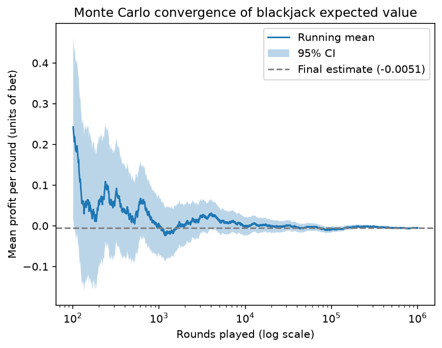

# Blackjack Monte Carlo

I built a blackjack simulator written in Python. It plays millions of hands of 6-deck blackjack with basic strategy and estimates the house edge, with a confidence interval, by Monte Carlo simulation.

The next stages add card counting (Hi-Lo) and bet sizing, to see how much of an edge a counter can actually get and how much risk comes with it.

## Rules simulated

- 6 decks, reshuffled at 75% penetration (cut card)
- Dealer stands on soft 17
- Dealer checks for blackjack before the player acts
- Blackjack pays 3:2
- Double down on any first two cards, including after a split
- Split once (no re-splitting); split aces get one card each
- No surrender, no insurance

The player follows standard basic strategy for these rules, stored as lookup tables for hard totals, soft totals and pairs (`blackjack/strategy.py`).

## Results

Each round's profit is recorded in units of the bet. The house edge is minus the mean profit per round, and the 95% confidence interval comes from the Central Limit Theorem (mean ± 1.96 · s/√n).

| Rounds | House edge | 95% CI (mean profit) | Std. dev. |
|---|---|---|---|
| 10,000 | 0.14% | [-0.0240, 0.0212] | 1.151 |
| 1,000,000 | 0.51% | [-0.0074, -0.0029] | 1.147 |
| 10,000,000 | 0.44% | [-0.0051, -0.0037] | 1.147 |

10 million hands give a house edge of 0.44% (95% CI: 0.37%–0.51%), in line with published figures of around 0.4–0.5% for these rules.

A few things stand out:

- At 10,000 hands the confidence interval still contains zero, so you can't even tell the game apart from a fair one. The standard deviation of a single hand is also about 1.15 units, around 200 times the size of the edge. Hence the illuzion of fair chance in blackjack.
- 100 times more hands makes the interval 10 times narrower, which is the 1/√n rate you'd expect.

### Convergence



The running mean over 1 million seeded hands, with the 95% confidence band at each point. For the first few thousand hands the mean is often positive, so a player at that point could easily think they were beating the casino. The final estimate stays inside the band the whole way, so those early "winning" stretches are just noise.

## Project structure

```
blackjack/
    cards.py       # shoe and hand value (soft/hard aces)
    game.py        # one round: dealing, player and dealer play, doubling, splitting, settlement
    strategy.py    # basic strategy tables and decision function
    simulate.py    # runs n rounds and computes summary statistics
    plots.py       # convergence plot
tests/             # pytest unit tests
results/           # saved figures
```

## Running it

```bash
git clone https://github.com/dan-craciun/blackjack-monte-carlo.git
cd blackjack-monte-carlo
python3 -m venv .venv
source .venv/bin/activate
pip install -r requirements.txt

python -m blackjack.simulate   # run the simulation and print the statistics
python -m blackjack.plots      # make the convergence plot
python -m pytest -v            # run the tests
```

Runs are seeded, so the same settings give the same numbers.

## Next steps

- Hi-Lo card counting: track the running and true count and estimate the player's edge as a function of the true count
- Effect of penetration on a counter's edge
- Bankroll analysis: flat betting vs. a bet spread vs. Kelly betting, compared by growth and risk of ruin
- Possibly: derive basic strategy from expected values instead of using the published tables, and compare rule variations (6:5 blackjack, dealer hits soft 17, re-splitting)