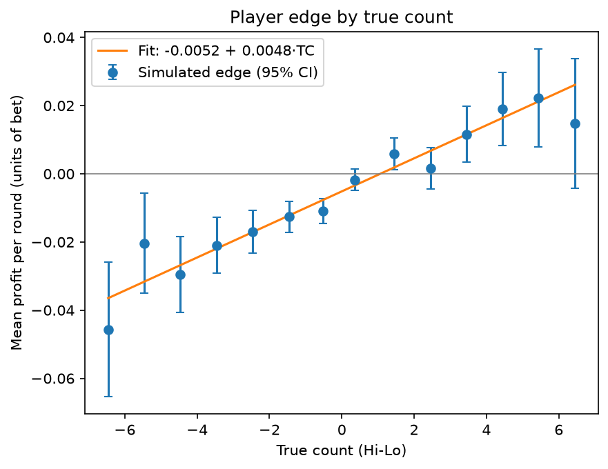
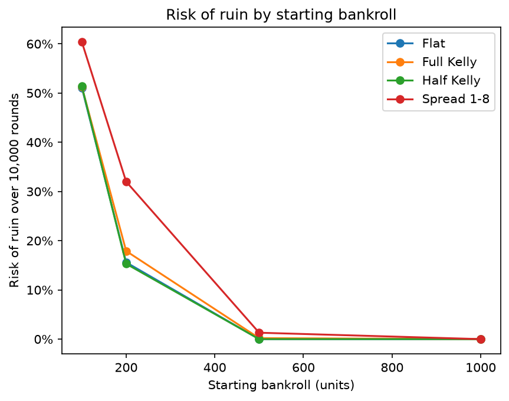

# Blackjack Monte Carlo

I built a Python simulator that plays millions of hands of 6-deck blackjack with basic strategy and estimates the house edge, with a confidence interval, by Monte Carlo simulation. I then added Hi-Lo card counting, measured how the player's edge changes with the count, and compared four bet sizing strategies by profit and risk of ruin.

## Rules I simulated

- 6 decks, reshuffled at 75% penetration (cut card)
- Dealer stands on soft 17
- Dealer checks for blackjack before the player acts
- Blackjack pays 3:2
- Double down on any first two cards, including after a split
- Split once (no re-splitting); split aces get one card each
- No surrender, no insurance

The player follows standard basic strategy for these rules, which I stored as lookup tables for hard totals, soft totals and pairs (`blackjack/strategy.py`).

## 1. House edge

I record each round's profit in units of the bet. The house edge is minus the mean profit per round, and I get the 95% confidence interval from the Central Limit Theorem (mean ± 1.96 · s/sqrt(n)).

| Rounds | House edge | 95% CI (mean profit) | Std. dev. |
|---|---|---|---|
| 10,000 | 0.14% | [-0.0240, 0.0212] | 1.151 |
| 1,000,000 | 0.51% | [-0.0074, -0.0029] | 1.147 |
| 10,000,000 | 0.44% | [-0.0051, -0.0037] | 1.147 |

With 10 million hands I get a house edge of 0.44% (95% CI: 0.37%–0.51%), in line with published figures of around 0.4–0.5% for these rules. I used this as my main check that the game engine plays blackjack correctly.

What stood out:

- The standard deviation of a single hand is about 1.15 units, about 200 times the size of the edge. Hence why blackjack feels like pure luck.
- At 10,000 hands the confidence interval still contains zero, so you can't necessarily tell the game apart from a fair one.
- 100 times more hands makes the interval 10 times narrower, which is the 1/√n rate you'd expect.


This is the running mean over 1 million seeded hands, with the 95% confidence band at each point. For the first few thousand hands the mean is often positive. The final estimate stays inside the band the whole way, so those early "winning" stretches are just noise.

## 2. Card counting: edge by true count

I added a Hi-Lo count (+1 for 2–6, 0 for 7–9, −1 for tens and aces). Since Hi-Lo is a balanced count, the running count of the cards dealt is just minus the count of the cards still in the shoe, so I compute it from what's left. The true count is the running count divided by the exact number of decks remaining. I measure it at the start of each round, before any cards are dealt, because that's the moment a counter places their bet.

I grouped the rounds by true count (rounded down) and computed the mean profit with a 95% confidence interval for each group, dropping groups with fewer than 10,000 rounds. I then fitted a line through the groups by weighted least squares (weights 1/SE), using each group's average true count as x.

From 2 million seeded rounds I got:

**edge(TC) = −0.52% + 0.485% × TC**

| True count | Player edge | 95% CI |
|---|---|---|
| −3 | −1.70% | [−2.32%, −1.08%] |
| −1 | −1.09% | [−1.46%, −0.72%] |
| 0 | −0.17% | [−0.48%, 0.13%] |
| +1 | +0.58% | [0.12%, 1.04%] |
| +3 | +1.16% | [0.34%, 1.98%] |
| +5 | +2.22% | [0.79%, 3.66%] |



- Each extra point of true count is worth about half a percent to the player, which matches the usual rule of thumb.
- The edge turns positive at a true count of about +1. Below that the house has the advantage; above it the player does.
- About three quarters of rounds start below a true count of +1, and only around 8% at +3 or higher. The good situations are rare, which is why counting only pays if you bet more when they come up.

My counter is idealised: it knows the exact number of decks left and never makes a mistake. 

## 3. Bet sizing and risk of ruin

Here the player keeps playing basic strategy and only changes the bet size, based on the true count at the start of the round. I compared four strategies:

| Strategy | Bet (in units, 1 unit = table minimum) |
|---|---|
| Flat | always 1 |
| Spread 1-8 | 1 below TC 2, then 2, 4, 6 and 8 units at TC 2, 3, 4 and 5+ |
| Full Kelly | bankroll × edge(TC) / σ², using the fitted line above and σ² = 1.1466²; 1 unit when the edge is ≤ 0 or the Kelly bet is below the minimum |
| Half Kelly | half of the full Kelly bet, at least 1 unit |

The cards and the playing decisions don't depend on the bet size, so I simulate the rounds once and apply every strategy to the same sequence of hands (common random numbers). That way, differences between the strategies come from bet sizing alone, not from luck in the cards.

I ran 1,000 sessions of 10,000 rounds each. I count a session as ruined if the bankroll drops below 1 unit.

### Starting bankroll of 1,000 units

| Strategy | Mean profit | 95% CI | Median profit | 5th → 95th percentile |
|---|---|---|---|---|
| Flat | −44 | [−51, −37] | −43 | −228 → +139 |
| Spread 1-8 | +35 | [+21, +50] | +32 | −332 → +414 |
| Half Kelly | +65 | [+47, +84] | +27 | −362 → +637 |
| Full Kelly | +215 | [+173, +257] | +75 | −558 → +1,489 |

- Flat betting loses 44 units on average over 10,000 rounds, which is exactly the 0.44% house edge from section 1.
- All three counting strategies are profitable, and their confidence intervals are clear of zero. The profit is small compared to the swings, though: with the spread, 1 session in 20 still ends more than 330 units down.
- Full Kelly grows the bankroll fastest, but its outcomes are by far the widest, and its mean is well above its median. A few very lucky sessions pull the mean up, so the median is the better guide to what a typical player gets.
- Half Kelly has about half the spread of outcomes of full Kelly, which is the usual argument for betting less than full Kelly.

### Risk of ruin by starting bankroll

| Starting bankroll | Flat | Spread 1-8 | Half Kelly | Full Kelly |
|---|---|---|---|---|
| 100 | 51.1% | 60.4% | 51.4% | 51.3% |
| 200 | 15.6% | 32.0% | 15.3% | 17.9% |
| 500 | 0.0% | 1.3% | 0.0% | 0.2% |
| 1,000 | 0.0% | 0.0% | 0.0% | 0.0% |



- With 100 units, about half of all players go broke whatever they do. The swings in 10,000 rounds are much larger than the bankroll.
- The result that surprised me most: the spread has a positive expected profit but goes broke more often than flat betting at small bankrolls. Betting 8 units at high counts means one bad run can wipe out a small bankroll before the edge has time to show. It needs around 500 units to be reasonably safe.
- At small bankrolls Kelly behaves almost exactly like flat betting (the Flat line is hidden behind Half Kelly in the chart). The Kelly bet is below the table minimum at most counts, so the player is forced to bet 1 unit. The minimum bet is what makes ruin possible under Kelly at all.
- For the same reason, Kelly's profit grows faster than its bankroll: at 500 units full Kelly makes +71 on average, at 1,000 units +215.

One simplification: if a player with 1 unit left doubles or splits and loses, I set the bankroll to 0 rather than letting it go negative.

## Project structure

```
blackjack/
    cards.py               # shoe and hand value (soft/hard aces)
    game.py                # one round: dealing, player and dealer play, doubling, splitting, settlement
    strategy.py            # basic strategy tables and decision function
    simulate.py            # runs n rounds, records profit and true count, summary statistics
    counting.py            # Hi-Lo values and true count
    analysis.py            # edge by true count and the fitted line
    betsize.py             # bet sizing strategies and bankroll paths
    compare_strategies.py  # runs every strategy over many sessions and bankrolls
    plots.py               # charts
tests/                     # pytest unit tests
results/                   # saved figures
```

## Running it

```bash
git clone https://github.com/dan-craciun/blackjack-monte-carlo.git
cd blackjack-monte-carlo
python3 -m venv .venv
source .venv/bin/activate
pip install -r requirements.txt

python -m blackjack.simulate            # house edge and summary statistics
python -m blackjack.plots               # convergence plot
python -m blackjack.analysis            # edge by true count, fitted line and chart
python -m blackjack.compare_strategies  # bet sizing comparison and risk of ruin chart
python -m pytest -v                     # run the tests
```

All runs are seeded, so the same settings give the same numbers. The strategy comparison simulates 10 million rounds and takes a while. The seed I used is 42. 

## What I'd like to add next

- Playing deviations (e.g. the "Illustrious 18"): change playing decisions at certain counts, not just the bet size, and measure what they add
- The effect of penetration on a counter's edge
- Deriving basic strategy from expected values instead of using the published tables
- Comparing rule variations: 6:5 blackjack, dealer hits soft 17, re-splitting